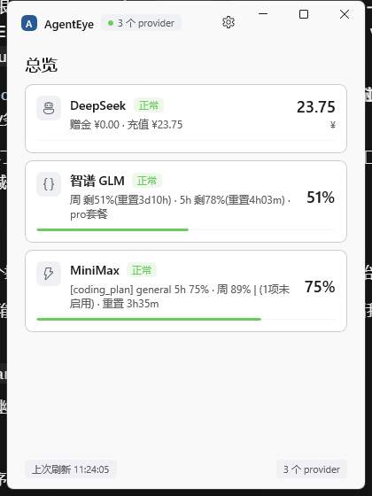
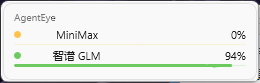

# AgentEye

Windows 桌面多 Key AI 额度观察工具(WinUI 3 重写版)。一个 Acrylic 紧凑面板 +
托盘常驻 + 桌面小组件,盯着各平台 API 额度,快烧完时提前告警。


<p align="center">
  
  &nbsp;&nbsp;&nbsp;&nbsp;
  
</p>

> 与 Python/Tkinter 原版(存于 `main` 与 `feat/glass-redesign` 分支历史)共用
> 同一份 `~/.agenteye/config.json` 与缓存目录,可直接替换使用。

## 功能

- **多 provider 额度总览**:内置 6 种适配器 —— DeepSeek / 智谱 GLM / MiniMax /
  OpenCode.Go / 中转站 / 通用 OpenAI 兼容;展示余额、套餐余量与周消耗。
  轮询周期可调(`refresh_interval_sec`,默认 30s),models/probe/alert 三层
  缓存落盘,重启不重查。
- **主面板**:420×560 紧凑毛玻璃面板(单窗、无导航栏、图标头部),总览页
  (全部 provider 行)+ 设置页(外观 / 告警 / API 管理)。玻璃依赖系统
  「透明效果」开关;关闭时 Windows 不渲染 Acrylic,自动退化为不透明底色
  (系统策略,非缺陷)。
- **托盘常驻**:Shell_NotifyIconW + 纯 GDI 渲染的应用 A 标,按额度紧张度
  染色(蓝→绿→橙→红,无数据走灰)+ 右下角数字牌(最紧张 provider 的已用
  百分比)。左键唤起主面板,右键菜单(暂停轮询 / 立即刷新 / 切换小组件 / 退出)。
- **桌面小组件**:无边框置顶 260×64(高度随行数自适应),Acrylic 背板,
  不抢焦点(WS_EX_NOACTIVATE);按住拖动、松手位移 < 4px 判定为点击并唤起
  主面板,位置落盘记忆。
- **全局快捷键**:默认 `Ctrl+Shift+A` 一键唤醒主面板(最小化 / 被遮挡都能
  唤回并置前);面板在前台时再按一次则**藏回托盘**。设置页的「唤醒快捷键」
  文本框既可手打(`ctrl+shift+a`,大小写不敏感)也可直接按组合键录入,
  「清除」即停用;落盘 `ui.hotkey`,改完立即生效。组合被别的程序占用时
  设置页给出提示,不影响其它功能。热键仅在 AgentEye 运行期间生效。
- **开机自启动**:设置页开关写 HKCU 启动项(与安装器同一条),开机静默进
  托盘不弹主面板。
- **设置页**:按 Windows 11 设置的卡片行版式重排 —— 外观模式(下拉)/
  开机自启动 / 语言(1.3.0 起可切中英) / 唤醒快捷键 / 告警阈值 /
  API 管理 / 高级(主面板宽高)/ 关于软件。
- **阈值告警**:默认剩余 < 30% 预警、余额 < ¥5 临界(均可在 config 调);
  WinRT toast 通知,同一 provider 同一等级 60 分钟冷却,等级升级(黄转红)
  立即重警;toast 不可用时降级 MessageBeep。
- **密钥安全**:API Key 仅内存态明文,磁盘态经 DPAPI(CurrentUser)加密存
  `key_enc`;环境变量 `*_API_KEY` 可临时覆盖且绝不落盘。
- **自动更新**:GitHub Releases 检查新版,应用内下载 → sha256 校验 →
  静默安装 → 自动重启(细节见下文[更新](#更新))。

## 系统要求

- Windows 10 1809(build 17763)及以上 / Windows 11,x64
- 系统需已安装运行时(安装器为框架依赖发行,不打包运行时):
  - [.NET 8 Desktop Runtime](https://dotnet.microsoft.com/download/dotnet/8.0)
  - [Windows App Runtime 1.7](https://learn.microsoft.com/windows/apps/windows-app-sdk/downloads)
- 毛玻璃效果需要系统「设置 → 个性化 → 颜色 → 透明效果」开启

## 下载安装

从 [Releases](https://github.com/Cecilian-Elysian/AgentEye/releases/latest)
下载 `AgentEye_Setup.exe` 双击安装(Inno Setup,lzma2 压缩约 7.9 MB):

- 按用户级安装(HKCU),**无需管理员**;默认装到 `E:\AgentEye`,全新安装可改目录
- 可选桌面快捷方式与开机自启;开始菜单 / 系统设置「应用」自带卸载入口
- 升级时安装器经 Restart Manager 关闭运行中的应用,装完自动重启新版
- 配置与缓存都在 `~\.agenteye\`,与安装位置无关,升级 / 重装不丢配置

## 配置

配置文件:`~/.agenteye/config.json`(v2 schema)。设置页只暴露 url / key /
model 三项,其余字段手改后重启生效:

| 键 | 默认 | 说明 |
|---|---|---|
| `refresh_interval_sec` | 30 | 轮询周期(秒) |
| `alert.enable` | true | 告警总开关 |
| `alert.warn_pct` | 30 | 剩余百分比低于此值预警(黄) |
| `alert.critical_amount_yuan` | 5.0 | 余额低于此值(元)临界(红) |
| `ui.theme` | "auto" | `light` / `dark` / `auto` |
| `ui.width` / `ui.height` | 420 / 560 | 主窗尺寸(物理像素,320×400 ~ 800×1200) |
| `ui.widget` | false | 桌面小组件开关 |
| `ui.hotkey` | "Ctrl+Shift+A" | 全局快捷键组合(唤醒/隐藏主面板) |
| `ui.hotkey_enabled` | true | 全局快捷键开关 |
| `ui.autostart` | false | 开机自启动镜像值(真实状态以 HKCU 启动项为准) |
| `ui.language` | "zh-Hans" | 界面语言(中英双语自 1.3.0 起可切) |
| `providers[]` | [] | 列表项:`id` / `kind` / `name` / `base_url` / `key_enc` |

- `kind` 取值:`deepseek` / `zhipu` / `minimax` / `opencode_go` / `relay` /
  `generic_openai`(通用 OpenAI 兼容);`key_enc` 由应用写入,手改 config 只需
  留空,回到设置页填 key 即可
- **损坏自愈**:JSON / 编码 / 根类型坏 → 原文件改名
  `config.json.corrupt-<时间戳>-<随机>` 保留,按模板重启,绝不覆盖原文
- **v1 自动迁移**:旧版 5 个分立数组配置自动升级,原文件 DPAPI 加密备份为
  `.v1.bak`

## 构建与测试(开发者)

依赖 .NET SDK 8+(含 Windows 工作负载)与 Windows App SDK 1.7,无需 Visual Studio:

```powershell
dotnet build src\AgentEye.WinUI -c Debug
dotnet test tests\AgentEye.Core.Tests
```

130 个测试覆盖配置层(v2 schema、DPAPI、v1 迁移、损坏隔离)、provider 层
(探测、6 种适配器、中转站、缓存、告警状态)与快捷键解析(组合解析 / 校验 /
往返)。

一键发布(publish → 剪 pdb → `dist\` 便携目录 → `installer\AgentEye_Setup.exe`,
需 Inno Setup 6):

```powershell
powershell -NoProfile -ExecutionPolicy Bypass -File build.ps1
```

应用图标由 `tools\make_icon.py` 生成(Pillow,dev-only,不在构建流程里),
源文件 `src\AgentEye.WinUI\Assets\AgentEye.ico`。

## 更新

- 更新源:GitHub Releases;启动时后台静默检查一次(同一自然日只查一次),
  有新版弹 toast 提示
- 设置页「关于」区可随时手动「检查更新」,发现新版可「下载并更新」:
  应用内下载安装器 → sha256 校验 → `/VERYSILENT` 静默安装 → 安装器经
  Restart Manager 关旧进程、覆盖安装、自动重启新版
- 安装目录不可写时,应用在下载前就拒绝并提示手动修复
- `AGENTEYE_UPDATE_API` 可覆盖更新 API 基址(镜像 / 自建实例 / 本地联调)
- 发布格式约定见 `docs\RELEASE.md`

## 文件结构

```
src\AgentEye.Core        逻辑层(net8.0,无 UI 依赖)
  Config\                v2 schema 读写、DPAPI 加密、迁移与损坏隔离
  Providers\             探测与 6 种 provider 适配器 + 中转站
  Security\              DpapiCrypt(密钥加解密)
  Cache\                 models/probe/alert 状态缓存
  Update\                版本比较、release 解析、下载校验、安装器拉起
  Hotkeys\               HotkeySpec(快捷键组合解析,纯逻辑)
src\AgentEye.WinUI       壳层(WinUI 3)
  Assets\                AgentEye.ico(应用图标,唯一来源)
  Pages\                 OverviewPage / SettingsPage
  Services\              AeRes / AeAppIcon / AppServices / PollerService / NotifyService / UpdateService / HotkeyService / StartupService
  Styles\                AeStyles.xaml(工程自有样式)
  Tray\                  托盘(纯 Win32 + GDI):TrayIconService / TrayIconRenderer
  Widget\                桌面小组件
tests\AgentEye.Core.Tests
tools\make_icon.py       图标生成器(Pillow,dev-only)
docs\                    发布约定与改造计划
```

工程契约(资源取用、XAML 坑、config 兼容)见 `AGENTS.md`;改造执行计划
收录于 `docs\PLAN-winui-acrylic.md`;发布格式约定见 `docs\RELEASE.md`;
变更记录见 `CHANGELOG.md`。

## 与 Python 版的已知差异

- 模型列表面板(原版 `Panel` 的 models 视图)暂未移植,models 缓存仍会写入。
- 设置页表单为同窗切换(列表 <-> 表单),交互对齐原版但视觉为 Fluent 控件。
- 托盘菜单"切换小组件"对应原版小组件显隐开关。
